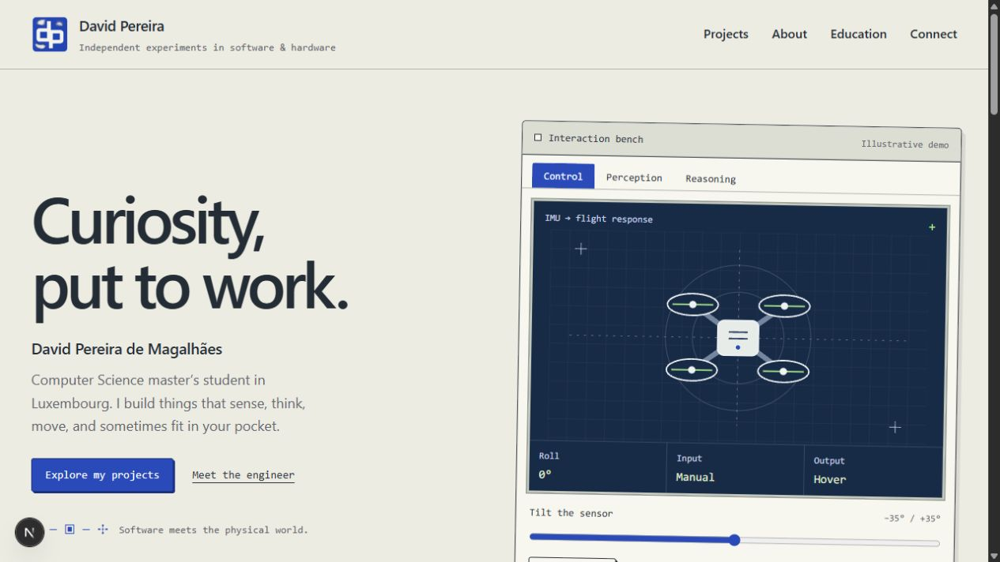
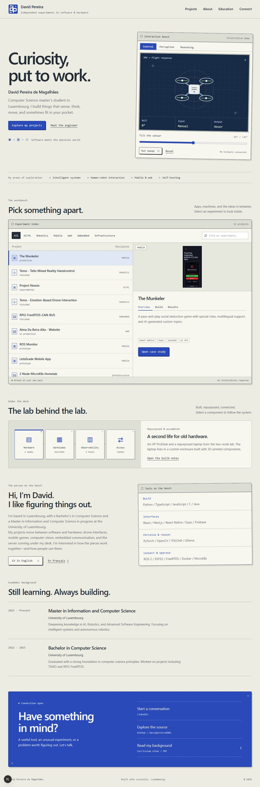

# David Pereira de Magalhães — Portfolio

An interactive engineering workstation for my work in AI, robotics, embedded systems, web and mobile development, and self-hosting.

**[Visit pearlabs.dev](https://pearlabs.dev/)** · [LinkedIn](https://www.linkedin.com/in/davidpereira2803/) · [GitHub](https://github.com/Davidpereira2803)

## Preview



<details>
<summary>View the complete homepage</summary>



</details>

## The idea

The portfolio feels like a small research workstation: warm ivory panels, cobalt controls, a custom DP monogram, and instrument-style interfaces. Visitors can explore immediately, without a boot sequence, terminal commands, or sound.

- **Interaction bench:** switch between Control, Perception, and Reasoning; move a sensor slider, run a sweep, or reset the drone illustration.
- **Project workbench:** search and filter projects, select an experiment, and switch between Overview, Build, and Results.
- **Project dossiers:** read the problem, contribution, technical approach, outcomes, and image/video gallery on dedicated pages.
- **Homelab explorer:** inspect the hardware, workloads, observability, and access components.
- **Background and education:** explore my tools and academic history, with English and French CV downloads.
- **Professional contact:** connect through GitHub and LinkedIn. No email address is displayed in the interface.

The instrument and homelab diagram are illustrative. They do not connect to live robots or expose server telemetry.

## Stack

| Part | Technology |
| --- | --- |
| Application | Next.js 16 App Router, React 19, TypeScript |
| Styling | Tailwind CSS 4 and custom CSS |
| Typography | IBM Plex Sans and IBM Plex Mono through `next/font` |
| Content | Typed project and education data |
| Hosting | Static export deployed to GitHub Pages |
| Checks | Production build, metadata validation, and Playwright browser checks |

## Run locally

Use Node.js 20.9 or later and npm.

```powershell
git clone https://github.com/Davidpereira2803/Davidpereira2803.github.io.git
cd Davidpereira2803.github.io
npm ci
npm run dev
```

Open [http://localhost:3000](http://localhost:3000). Keep the terminal running and press **Ctrl+C** to stop the server.

If port 3000 is occupied:

```powershell
npm run dev -- --port 3001
```

The public portfolio does not require environment variables or API credentials. Initial setup needs network access for npm packages and the Google Fonts download.

## Build and preview the static site

```powershell
npm run build
python -m http.server 4173 --directory out
```

Open [http://localhost:4173](http://localhost:4173). Python is only needed for this simple static-preview command; another static HTTP server can serve `out/` too.

The site uses `output: "export"` and trailing slashes. Deploy the contents of `out/`; a persistent Node.js server is not required.

## Project structure

| Path | Purpose |
| --- | --- |
| `src/app/` | Homepage, shared layout, metadata, favicon, and project routes |
| `src/components/workstation/` | Main workstation, instrument, project browser, and homelab explorer |
| `src/components/layout/` | Shared navigation and footer |
| `src/components/sections/project-details.tsx` | Project dossier interface |
| `src/data/projects.ts` | Project descriptions, media, links, tags, and case studies |
| `src/data/experience.ts` | Education records |
| `src/data/clients.ts` | Optional client-project records |
| `public/cv/` | Public English and French CVs |
| `public/project-visuals/` | Project illustrations |
| `docs/images/` | README screenshots |
| `scripts/` | Metadata utilities, browser checks, and screenshot capture |
| `.github/workflows/` | Verification, deployment, and project metadata sync |

## Update the content

Edit `src/data/projects.ts` to add or update a project. Each project has a unique slug, title, description, category, tags, media, and optional case-study fields. Slugs generate routes such as `/projects/ros-monitor/`; keep established slugs when renaming a project to preserve links.

Use source-code links for repositories and demo links for actual demonstrations. Screenshots and videos should show the project itself. Keep experiments, prototypes, coursework, and production work clearly identified.

Edit `src/data/experience.ts` for education and `src/components/workstation/workstation.tsx` for the introduction and contact content. Keep text files in UTF-8 so **Magalhães** and other accents remain correct.

### Automated project metadata

The `Receive project metadata sync` workflow accepts the `project_metadata_updated` repository-dispatch event. It saves the incoming project JSON under `data/projects/`, validates it, and updates the matching entry in `src/data/projects.ts`.

An incoming record replaces the existing project entry. When a project has automated sync, keep its source metadata consistent with the portfolio so later syncs preserve branding, media, and case-study content.

### CV updates

Deployment copies the maintained PDFs from:

- `assets/cv/cv-latest.pdf` to `public/cv/cv-en.pdf`
- `assets/cv/cv-latest-fr.pdf` to `public/cv/cv-fr.pdf`

The public download URLs remain stable.

## Browser checks

The verification workflow builds the site, validates project metadata, and checks the main interactions in Chromium. It covers sensor controls, filters, search, keyboard-operated tabs, the homelab explorer, case studies, contact navigation, the logo/favicon, mobile navigation, horizontal overflow, and absence of email links.

To run the same checks locally, first build and serve `out/` on port 4173 in one terminal. In a second terminal:

```powershell
npm install --no-save --package-lock=false playwright
npx playwright install chromium
node scripts/verify-workstation.mjs
```

Screenshots are written to `.review/` and uploaded with the static build as the workflow artifact `retro-workstation-preview`.

### Refresh README screenshots

With the development server running on port 3000, or after setting `PORTFOLIO_URL` to another URL:

```powershell
node scripts/capture-readme.mjs
```

This uses the same Playwright installation to save desktop and full-page screenshots under `docs/images/`. Review and commit the images with any visual changes.

## Deploy

Push or merge the reviewed changes to `main`. The `Build and Deploy to GitHub Pages` workflow:

1. Installs the locked dependencies with `npm ci`.
2. Copies the current CV PDFs into `public/cv/`.
3. Builds the static site with Next.js.
4. Uploads `out/` and deploys it to GitHub Pages.

The workflow also runs after a successful project metadata sync. GitHub Pages uses the `github-pages` environment and the `pearlabs.dev` custom domain. No Vercel deployment is required.

For repository setup, select **GitHub Actions** as the Pages source and retain the custom-domain configuration and DNS records.

## Accessibility and motion

The interface includes visible keyboard focus, a skip link, labeled controls, keyboard navigation for dossier tabs, and responsive navigation. Reduced-motion preferences disable decorative transitions and the automatic sensor sweep. Images have descriptive alternative text; video galleries expose playback controls.

## Ownership

Source, original project material, screenshots, and personal branding belong to David Pereira de Magalhães unless otherwise credited. Third-party dependencies and project assets retain their respective licenses. This repository does not grant a blanket open-source license.
